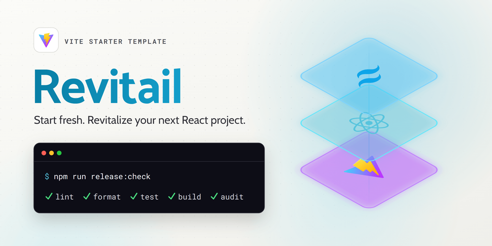

<p align="center">
  <a href="https://vitereact.marcopontili.com">
  <picture>
    <source media="(prefers-color-scheme: dark)" srcset=".github/brand/readme-dark.png" />
    <source media="(prefers-color-scheme: light)" srcset=".github/brand/readme.png" />
    
  </picture>
  </a>
</p>

# Revitail: React, Vite and Tailwind starter

[](https://github.com/marcop135/revitail/actions/workflows/ci.yml)
[](https://github.com/marcop135/revitail/actions/workflows/deploy.yml)
[](https://github.com/marcop135/revitail/releases)
[](./LICENSE)
[](https://github.com/marcop135/revitail/commits/develop)
[](./.nvmrc)
[](https://react.dev/)
[](https://vite.dev/)
[](https://tailwindcss.com/)
[](https://vitest.dev/)

Every React project starts with the same chore: wiring linters, formatters, tests and CI, then checking it all works.
Revitail comes with all of it wired up and passing, on React 19, Vite 8 and Tailwind CSS v4.

Start fresh. Revitalize your next React project.

[Check the website](https://vitereact.marcopontili.com) · [Read the docs](./docs/README.md)

## What you get

- React 19, Vite 8 and Tailwind CSS v4
- ESLint, Stylelint, HTMLHint and Prettier with Tailwind class sorting
- Vitest and Testing Library, with coverage
- Husky pre-commit hook running lint-staged
- GitHub Actions for CI, tagged releases and Dependabot auto-merge
- `@/` import alias and `.env.example`
- Light and dark theme from CSS variables

## Quick start

You need Node.js 22 (pinned in `.nvmrc`).

```bash
git clone https://github.com/marcop135/revitail.git my-app
cd my-app && npm install
npm run dev
```

The dev server runs at `http://localhost:5173`. Next: [rename the project and remove the demo](docs/getting-started.md).

## Docs

| Doc                                        | Covers                                                        |
| ------------------------------------------ | ------------------------------------------------------------- |
| [Getting started](docs/getting-started.md) | Clean history, renaming, removing the demo, `@/`, env vars    |
| [Guides](docs/guides.md)                   | Routes, components with tests, TypeScript, upstream updates   |
| [Workflow](docs/workflow.md)               | Checks on save, commit and CI, tests, releases                |
| [Styling](docs/styling.md)                 | Tailwind v4, tokens, dark mode, fonts, utilities              |
| [Project](docs/project.md)                 | Scripts, layout, config, build output, browsers, a11y and SEO |
| [Deploy](docs/deploy.md)                   | Static hosting, SPA fallback, CSP, deploy workflow            |
| [Troubleshooting](docs/troubleshooting.md) | Common errors and their fixes                                 |

## Contributing

See [CONTRIBUTING.md](./CONTRIBUTING.md). Report vulnerabilities through [SECURITY.md](./SECURITY.md).

## Author

[Marco Pontili](https://marcopontili.com)

## License

[MIT](./LICENSE)
